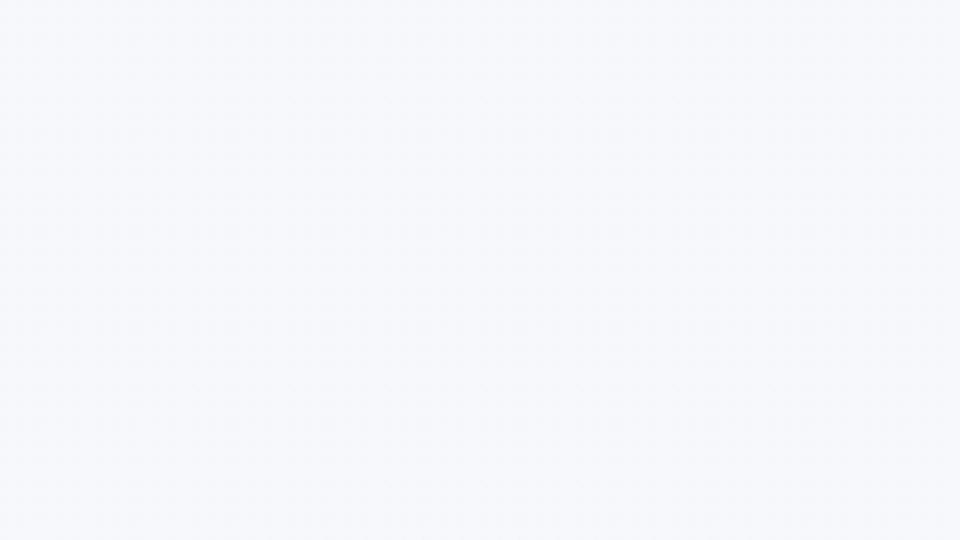

# 🛡️ mac-security-sweep: Collect the latest vulnerability reports and check your Mac for signs of compromise

[日本語](../../README.md#mac-security-sweep) | [English](README.en.md)

## Install

```bash
npx skills add -g laststance/skills --skill mac-security-sweep
```

## Usage (run the skill in your AI agent)

```text
/mac-security-sweep
```

## Walkthrough (Japanese)



[Read SKILL.md (Japanese)](../../skills/mac-security-sweep/SKILL.md)

[Download the MP4](https://github.com/laststance/skills/raw/refs/heads/main/docs/mac-security-sweep/walkthrough.mp4) · [Still image](walkthrough-poster.png) · [Interactive HTML](walkthrough.html)
